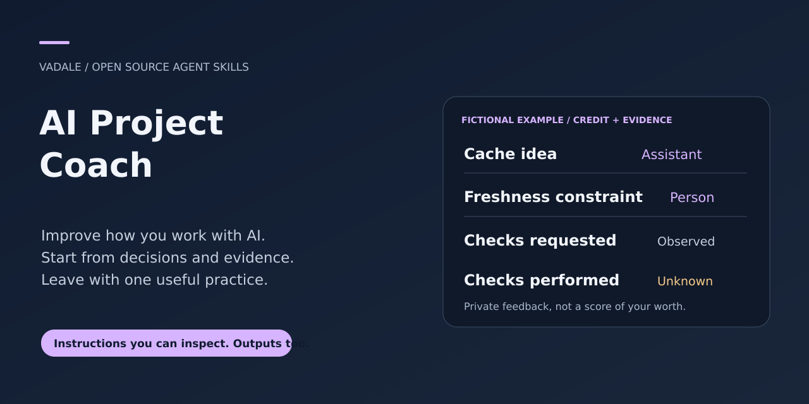
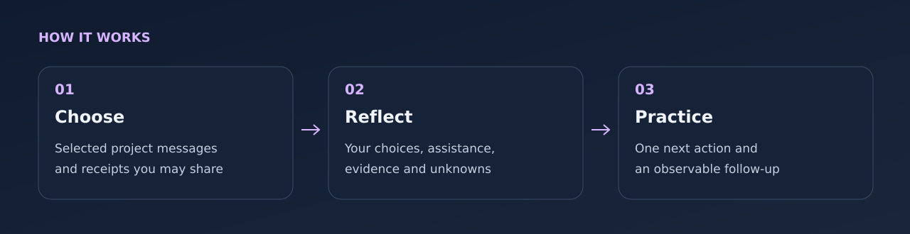

# AI Project Coach



[MIT](LICENSE) · [Download](https://github.com/Vadale/ai-project-coach-skill/releases) · [See an example](examples/worked-coaching.md)

**Understand what you do well when building with AI—and what to practise next.**
A prompt-only agent skill that turns selected project conversations and receipts
into private, evidence-grounded feedback. It credits human, model and team
contributions separately and proposes one concrete practice with a follow-up.

For people who plan, build or manage projects with LLMs: independent makers,
researchers, developers and product leads. You can start from a past project;
you do not need to read every line of code or supply your entire chat history.

## Install with skills.sh or Gemini CLI

Use the cross-agent installer and select your host:

```sh
npx skills add Vadale/ai-project-coach-skill --skill ai-project-coach
```

Or install the Gemini CLI extension from its packaged release:

```sh
gemini extensions install https://github.com/Vadale/ai-project-coach-skill
```

The host must have access to the materials you explicitly select. Installation does not grant access to other projects, accounts or conversations.

Restart the assistant session and confirm the skill is visible before use.
These packaging instructions do not establish full-workflow testing in every
client, automatic model selection or a gallery ranking.

## Pi, DeepSeek Harness and Hermes

These clients can load the same complete [skills/ai-project-coach](skills/ai-project-coach)
folder. Keep its references, scripts, runtime source and licenses together;
copying only `SKILL.md` loses required resources.

**Pi:** install this repository as a Git package:

```sh
pi install git:github.com/Vadale/ai-project-coach-skill
```

**DeepSeek Harness (DSH):** from a reviewed checkout, copy the complete
`skills/ai-project-coach` folder to `.dsh/skills/ai-project-coach/`
in your target project, or to its shared `.agents/skills/ai-project-coach/`
location. Choose a new destination; do not replace an existing skill silently.
DSH needs the skill folder directly under a recognized skills root, rather than
the whole repository nested there. See the
[DSH skill guide](https://github.com/deepseek-ai/deepseek-harness/blob/master/docs/subsystems/skills.md).

**Hermes:** inspect the exact source, then install through Skills Hub:

```sh
hermes skills inspect skills-sh/Vadale/ai-project-coach-skill/ai-project-coach
hermes skills install skills-sh/Vadale/ai-project-coach-skill/ai-project-coach
```

If catalog search has not indexed the skill, the complete folder can also be
copied to a new `~/.hermes/skills/ai-project-coach/` directory
(or your configured Hermes home). See the
[Hermes skill guide](https://hermes-agent.nousresearch.com/docs/user-guide/features/skills).

Reload or restart the client and confirm that `ai-project-coach` appears.
Native catalog/body loading was checked with Pi 1.4.0, the DSH filesystem skill
provider 0.0.1-rc.3, and Hermes source revision `e3cc65d767e3`.
These checks do not establish automatic selection, marketplace ranking or a
complete model-driven workflow. The requirements and permissions below still apply.

## Try a natural request

Once this skill is installed and visible to your assistant, try:

> From these selected project messages, help me see where I accepted AI output too quickly and choose one practice for my next change. Keep the feedback private.

Private, attributed feedback and one observable practice goal, supported only by the selected evidence.

See the [synthetic input/output example](examples/natural-request.md) for expected
behavior and nearby tasks that need another workflow. Automatic selection
depends on your host and model; explicit invocation remains available.

## What changes in your next task?

| Your question | What the coach provides |
|---|---|
| “Am I accepting AI output too quickly?” | Recorded acceptance and verification choices, with evidence and gaps |
| “What was my contribution?” | A reconstruction of who proposed, selected, adapted and checked each idea |
| “What should I improve first?” | One task-specific practice, an observable success condition and a follow-up plan |
| “Can I describe this in my portfolio?” | A separate, optional draft limited to supported claims and the audience/content you permit |

It considers systems thinking, critical thinking, idea integration, product
framing, delegation, verification and learning **where the selected evidence
supports them**. Unobserved behavior remains unknown; it is not a personal deficit.



## Install

In Codex, ask the built-in installer:

```text
$skill-installer install https://github.com/Vadale/ai-project-coach-skill/tree/main/skills/ai-project-coach
```

Or copy the complete [skills/ai-project-coach](skills/ai-project-coach) folder to
your assistant's documented skills location. Codex supports `~/.agents/skills/`
for user skills. Preserve license and linked resources; confirm discovery
and restart if necessary. [Official skill guide](https://developers.openai.com/codex/skills).

No Python, R, server, MCP connector or companion skill is required. Your host
assistant must be able to read the evidence you select. The skill supplies a
workflow, not new tool access or permission enforcement.

## Start with one episode

Choose a few messages around a real decision and, if available, its specification,
test receipt or result. Remove material you cannot share with your host model.
Give the files directly or name their authorized paths:

```text
Use $ai-project-coach on these selected messages and test receipts.
My goal is to improve how I choose checks before accepting an AI-made change.
Keep the report private. Distinguish my decisions from model suggestions and
unverified success claims. Give me one practice for the next change.
```

You receive a Markdown report with scope and evidence, supported strengths and
improvement opportunities, uncertainty, and one practice. The workflow reads
source evidence without editing original project files.

For a follow-up, supply the earlier target, baseline and the new episode:

```text
Use $ai-project-coach to revisit this practice with the new receipts.
Compare only what is comparable; state task differences and missing evidence.
Do not infer improvement just because this report sounds more positive.
```

Ask **separately** for a CV/portfolio draft and state its audience and allowed
content. The private report and evidence are not attachments to that draft.
Drafting a summary does not publish it.

## See it before using your own material

Read the short [fictional input](examples/synthetic-session.md), then its
[worked coaching report](examples/worked-coaching.md). It shows the distinction
between an assistant's cache idea, a person's freshness constraint, requested
checks and missing execution receipts. No person is being assessed in this demo.

The [blank private-report template](skills/ai-project-coach/assets/private-report.md)
shows the output structure. Use the skill instructions and linked references with
any compatible skill-capable assistant; standalone-chat use needs those resources
supplied explicitly and depends on the host.

## Evidence, privacy and limits

This is formative personal coaching. It is not an HR screening tool, a validated
human-assessment scale, psychological diagnosis, professional certificate or code
audit. It gives no percentile, seniority ranking or universal ability score.
An AI success claim is not a test receipt; selected messages cannot establish
general ability, original invention or causal improvement.

Development used synthetic internal cases and fresh-agent tasks. These checks
concern factual grounding, attribution, scope and sharing behavior. They do not
establish benefit for real people, psychometric validity or customer adoption.
There is no automatic background coach, reminder, chat importer or archive sync.
Markdown-first; no bundled renderer or tracking service.

Confidentiality depends on the host model and its tool controls. Instructions
alone are not an upload guard. Choose only evidence you may share with that host;
do not attach personal reports or private conversations to public issues.

## Contribute and reuse

[Open an issue](https://github.com/Vadale/ai-project-coach-skill/issues) with a small,
fictional reproduction of a problem. [Contribution guidance](CONTRIBUTING.md).
Skill prose was written for this product from its owner's requirements; no private
transcripts, proprietary benchmark data or third-party software are bundled.
[MIT license](LICENSE).

Related: [Sec-graph triage](https://github.com/Vadale/sec-graph-triage-skill) for security
finding evidence; [R Statistical Analysis](https://github.com/Vadale/r-statistical-analysis-skill)
for statistical work. Neither is required by the coach.
